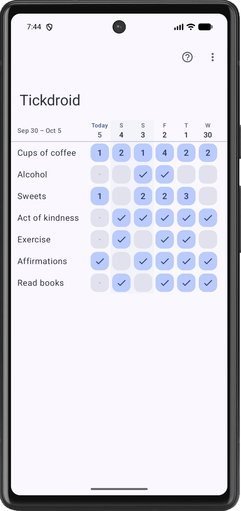
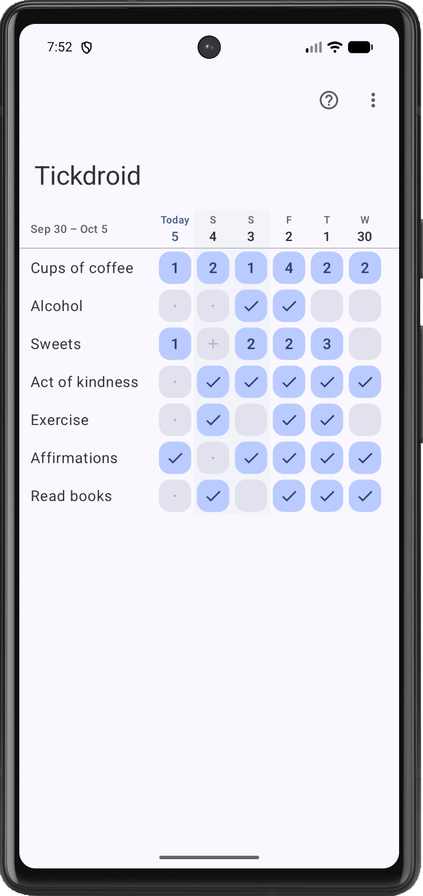
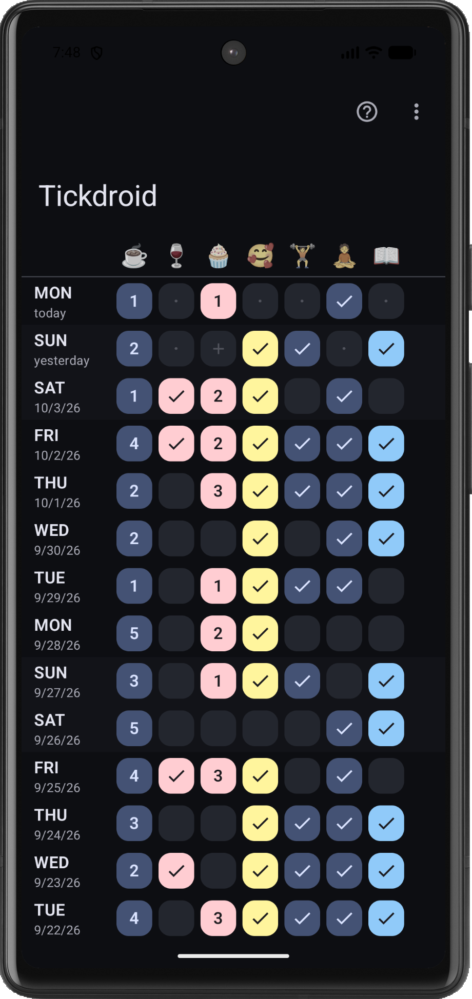
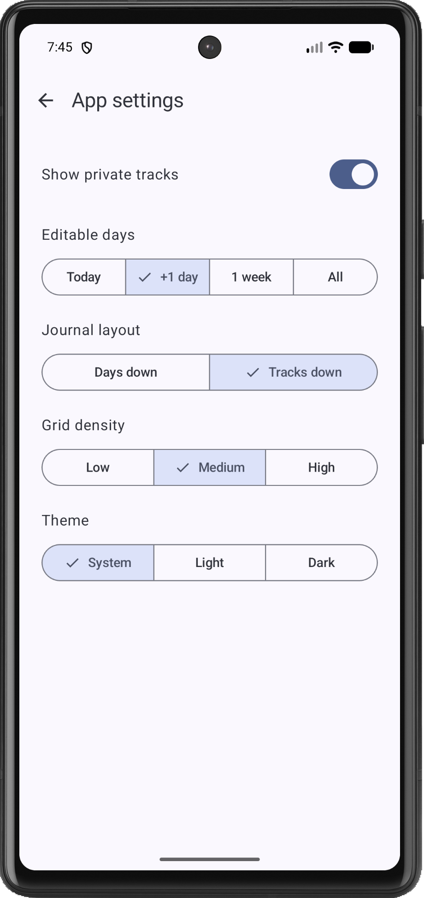
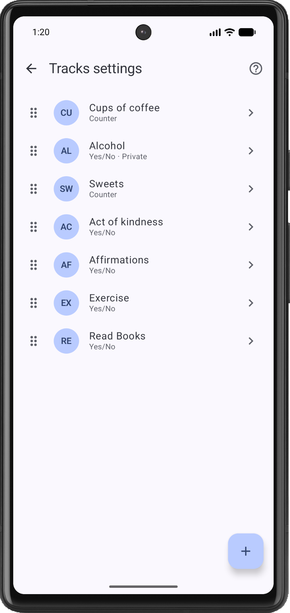
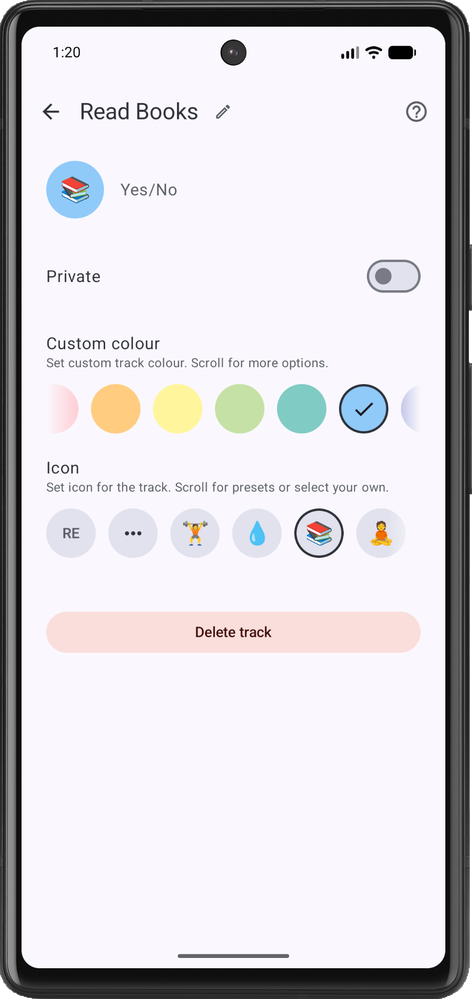
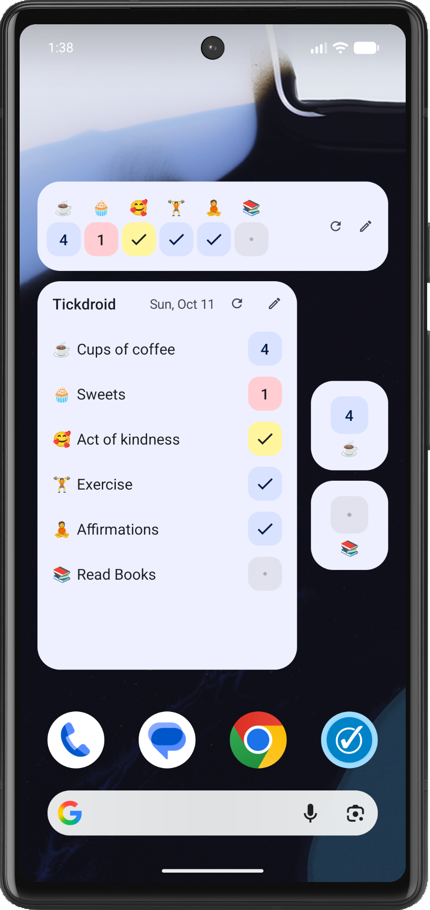

# Tickdroid

Tickdroid is the Android companion app for [Tickbuddy](https://github.com/martinhammer/tickbuddy), the daily habit and event tracker for Nextcloud. Please note that Tickdroid cannot be used as a standalone application, as it relies on the Tickbuddy/Nextcloud back-end.

Tickdroid lets you keep track of what happens each day, such as your meditation, exercise, or how many cups of coffee you had. Your scripts and AI agents can also log to Tickbuddy automatically, for example to record nightly backups, and their entries show up in Tickdroid too. Tickbuddy and Tickdroid are flexible: use them for habits, chores, keeping an eye on automations, or anything else that matters to you. Over time, analyse patterns and statistics with Tickbuddy’s built-in analytics.

Tickdroid is available via the F-Droid app store.

### Features
Some of the key features which already exist:
* Authenticate against Nextcloud server and verify that Tickbuddy is installed
* Two-way sync with Tickbuddy back-end
* Screen to display/edit tracks and ticks
* Today screen with streaks, and notes for each day (shared with Tickbuddy)
* Setting to control editable days
* System / light / dark theme setting
* Setting for main screen layout: days down versus tracks down
* Setting for grid density, i.e. size of the cells
* Add / remove / rename / toggle private / reorder / archive tracks
* Custom colours and emoji icons for tracks
* Landscape mode is handled gracefully
* Three types of homepage widgets

Planned features:
* Per-track statistics and visualisations
* Localisation
* Adoption of features from the Tickbuddy roadmap (goals, additional track types, etc.)
* ...and more once these goals are achieved

### Motivation
Tickdroid/Tickbuddy started as a habit tracker for Nextcloud, motivated by the lack of such an app in the Nextcloud ecosystem. Whilst habit tracking is still the major use case, they have been evolving towards a more flexible "daily everything-tracker" concept which supports many use cases beyond its original scope, in particular via integration with automations and AI agents.

The original inspiration for Tickbuddy and Tickdroid was the "one-bit journal" Android app [Tickmate](https://f-droid.org/en/packages/de.smasi.tickmate/).

This is a personal hobby project. Significant portion of the code has been written by Claude Code.

### Found a bug? Do you have a suggestion?

Feel free to get in touch and/or submit an issue.

### Screenshots

<table>
  <tr>
    <td align="center" valign="top" width="33%">
       
      Main screen – light theme, days down, default colours and headings
    </td>
    <td align="center" valign="top" width="33%">
       
      Main screen – light theme, tracks down, default colours and headings
    </td>
    <td align="center" valign="top" width="33%">
       
      Main screen – dark theme, days down, emojis as headings and custom colours
    </td>
  </tr>
  <tr>
    <td align="center" valign="top">
       
      App settings
    </td>
    <td align="center" valign="top">
       
      Track settings – list
    </td>
    <td align="center" valign="top">
       
      Track settings – individual track
    </td>
  </tr>
  <tr>
    <td align="center" valign="top">
       
      Home screen with widgets
    </td>
    <td></td>
    <td></td>
  </tr>
</table>
